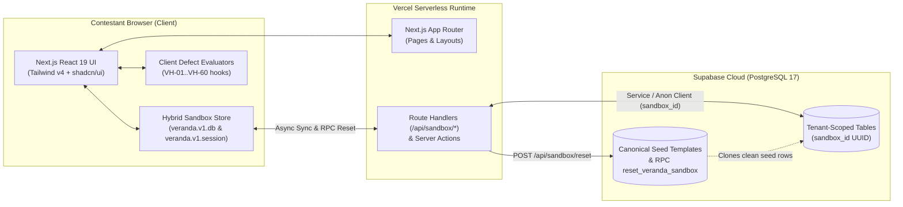
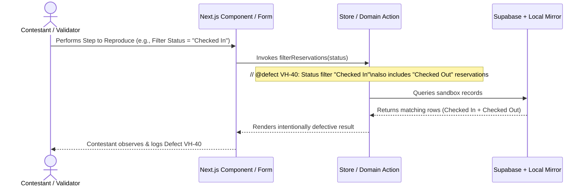

# Architecture Specification

**Status:** Architectural baseline complete (Milestone M0).  
**Deployment Topology:** Next.js 16 (App Router) on Vercel + Supabase PostgreSQL 17 with Hybrid Browser Sandbox Mirror.

---

## 1. System Boundary & High-Level Topology

**Veranda PMS** is architected specifically for the **PUPQC BSIT Foundation Month "Defect Hunt"** competition. It solves a unique engineering challenge:
1. It must run as a real full-stack cloud application deployed on **Vercel** and backed by **Supabase PostgreSQL**.
2. It must allow **50+ concurrent student contestants** to aggressively break, mutate, delete, tamper with, and reset the system simultaneously without affecting one another.
3. It must support **client-side DevTools inspection defects** (such as inspecting `localStorage` keys `veranda.v1.session` and `veranda.v1.db` in Chrome DevTools) alongside **database, API, calculation, UI, and routing defects**.



---

## 2. Hybrid Sandbox Persistence Architecture

Why does Veranda PMS combine **Supabase PostgreSQL** (`sandbox_id`-scoped tables) with a **Synchronized Browser Mirror (`localStorage`)**?

1. **Multi-Contestant Isolation on Supabase**:
   - On first visit, the application generates a cryptographic `sandbox_id` (UUID v4) stored in `veranda.v1.sandbox_id` (cookie + storage).
   - Calling `/api/sandbox/init` or `/api/sandbox/reset` executes the PostgreSQL RPC `reset_veranda_sandbox(p_sandbox_id UUID)` in Supabase, which atomically populates that `sandbox_id`'s isolated rows (`users`, `rooms_packages`, `allotment_adjustments`, `guests`, `reservations`, `reservation_items`, `password_reset_tokens`, `user_preferences`) from the canonical seed dataset.
   - All mutations write through to Supabase PostgreSQL scoped by `WHERE sandbox_id = $1` AND update the local mirror `veranda.v1.db`.
2. **Instant Deterministic DevTools Inspection**:
   - In *Defect Hunt*, several classic security and session defects require contestants to open `Chrome DevTools > Application > Local Storage` to inspect or edit `veranda.v1.session` and `veranda.v1.db` (specifically `VH-08`, `VH-13`, and `VH-14`).
   - By keeping `veranda.v1.db` and `veranda.v1.session` live in `localStorage` and hydrated from/synced to the browser's Supabase `sandbox_id` slice, contestants get **both** real Supabase cloud persistence **and** deterministic DevTools Application Storage behavior.
   - If Supabase network connectivity fluctuates on venue Wi-Fi during the competition, the Hybrid Store seamlessly continues operating against the local mirror and syncs back when connectivity resumes—guaranteeing **zero downtime during the live PUPQC event**.

---

## 3. Application Layers & Directory Structure

When scaffolded in Milestone M1, the Next.js 16 repository at `d:\repos\Defect_Hunt` follows this modular structure:

```text
d:\repos\Defect_Hunt\
├── AGENTS.md                        # Canonical AI agent instructions
├── CLAUDE.md                        # Pointer to AGENTS.md
├── GEMINI.md                        # Pointer to AGENTS.md
├── .agents/
│   ├── rules/                       # Numbered mandatory agent rules (00..70)
│   └── skills/                      # Task-specific agent skills (SKILL.md)
├── docs/                            # Comprehensive specification suite
├── supabase/
│   ├── migrations/                  # PostgreSQL DDL & RPC functions
│   └── seed.sql                     # Canonical Solstice Bay Resort seed dataset
├── src/
│   ├── app/                         # Next.js App Router pages & layouts
│   │   ├── (auth)/                  # /login, /register, /forgot-password, /reset-password
│   │   ├── (workspace)/             # Authenticated shell (/dashboard, /rooms, /reservations, /guests, /reports, /users, /settings)
│   │   ├── reservations/[id]/folio/ # Standalone printable Guest Folio route
│   │   └── api/sandbox/             # Supabase sandbox init, sync, and reset Route Handlers
│   ├── components/
│   │   ├── ui/                      # Customized shadcn/ui base primitives
│   │   ├── hospitality/             # Custom Veranda PMS domain components
│   │   └── layout/                  # Sidebar rail, topbar, mobile drawer, notifications popover
│   ├── lib/
│   │   ├── supabase/                # Supabase browser & server clients + sync adapter
│   │   ├── store/                   # Hybrid sandbox state & query/mutation actions
│   │   ├── domain/                  # Folio math, date helpers, CSV exporter, seed generator
│   │   └── defects/                 # Centralized defect registry & VH-01..VH-60 documentation tags
│   └── types/                       # TypeScript domain & database interfaces
└── tests/
    ├── unit/                        # Vitest domain & defect unit tests
    └── e2e/                         # Playwright E2E defect verification suite
```

| Layer | Responsibility |
|---|---|
| **App Router (`src/app/`)** | Route grouping, layouts, dynamic parameters (`/rooms/[id]`, `/reservations/[id]`, `/guests/[id]`), and custom 404 boundaries. |
| **Hybrid Data Store (`src/lib/store/`)** | Manages the active `sandbox_id`, hydrates state from Supabase / `veranda.v1.db`, executes mutations, and syncs changes to Supabase PostgreSQL via `/api/sandbox/sync`. |
| **Supabase Route Handlers (`src/app/api/sandbox/`)** | Server-side endpoints that invoke Supabase PostgreSQL queries and the `reset_veranda_sandbox(p_sandbox_id)` RPC using `@supabase/supabase-js`. |
| **Domain Calculators (`src/lib/domain/`)** | Folio billing calculations, date range filtering, timezone formatting, and CSV generation (containing documented `// @defect VH-XX` hooks where specified). |
| **UI Primitives (`src/components/ui/`)** | Base `shadcn/ui` components styled with **Cypress & Travertine** CSS variables. |
| **Hospitality Components (`src/components/hospitality/`)** | Custom domain components (`FolioMathBreakdown`, `AllotmentHealthBar`, `ReservationLifecycleStepper`, `RevenueOccupancyChart`, `DemoAccountsCard`, `GuestFolioPrintSheet`). |

---

## 4. Dual-Contract Defect Injection Architecture

A core requirement of **Veranda PMS** is that the 60 planted defects (`VH-01`..`VH-60`) must never be accidental spaghetti code. Every planted defect is an **explicit, documented architectural behavior** governed by [DEFECT_CATALOG.md](DEFECT_CATALOG.md).



### Defect Isolation Rules
1. **Explicit Code Annotations**: Every planted defect in the codebase is marked with a standardized comment block:
   ```typescript
   // @defect VH-32 (Hard | Reservations / totals | Functional)
   // Expected: VAT = 12% of (subtotal - discountAmount)
   // Actual: VAT is computed as 12% of gross subtotal before subtracting discountAmount
   ```
2. **No Collateral Breakage**: A defect planted in one screen must not crash unrelated screens. For example:
   - `VH-15` (Stored XSS on Folio print view) must only trigger on `/reservations/[id]/folio` while `/reservations/[id]` safely escapes the notes as plain text.
   - `VH-26` (Lexical string sort on `Rate (high to low)`) must only affect descending rate sort while ascending rate sort (`Rate (low to high)`) sorts numerically.
   - `VH-36` (Cancelling a `Confirmed` reservation fails to restore `available_units`) must only affect `Confirmed -> Cancelled` while `Pending -> Cancelled` restores `available_units` properly.
   - `VH-39` (Double-adding the `250.00` Service & Environmental Fee) must only occur on the Reservation Detail display (`/reservations/[id]`) while the Reservations List (`/reservations`) displays the canonical stored total.

---

## 5. Dynamic Seed Relative-Date Anchoring

In a live competition that may be held on any calendar date during PUPQC Foundation Month, dashboard filters (`Last 7 days`, `Last 30 days`) and timezone boundary defects (`VH-18`, `VH-19`, `VH-44`) depend on reservation timestamps relative to **the day the sandbox was initialized or reset**.

When a sandbox is initialized or reset (`reset_veranda_sandbox`):
- Recent reservations (`RSV-2043`, `RSV-2044`, `RSV-2045`) are anchored to **today** in local time (`Asia/Manila`).
- Specific boundary reservations are anchored to deterministic timestamps:
  - A reservation placed at **12:30 AM local time (`Asia/Manila`, `UTC+8`) on the 1st of the previous calendar month** (`4:30 PM UTC` on the last day of two months ago) so that `VH-18` (UTC month bucketing vs. local month bucketing) and `VH-44` (UTC timestamp display on detail page) always trigger reliably whenever the browser timezone is `Asia/Manila` (`UTC+8`).
  - A cancelled reservation (`RSV-2037`) is anchored inside the `Last 30 days` window so `VH-16` (Dashboard Total Revenue includes Cancelled reservations) and `VH-20` (ABV divides by all reservations including Cancelled) always produce an exact, verifiable discrepancy.

---

## 6. Failure & Operational Boundaries

- **Reset Demo Data Guarantee**: Clicking **Reset demo data** in the login footer (or workspace footer) clears all mutations in the current browser's `sandbox_id`, re-runs the deterministic relative-date seed generator in Supabase and `localStorage`, signs out any active session, and returns to `/login` with a confirmation toast.
- **Zero External Mail / Payment Dependencies**: Password reset links are rendered via an on-screen `"Open reset link"` preview toast/banner on `/forgot-password` so contestants never get blocked by university firewall SMTP filters or email rate limits.
- **Strict Asset Self-Containment**: Fonts (`Plus Jakarta Sans`, `Instrument Serif`, `JetBrains Mono`) and icons (`lucide-react`) are bundled locally via npm packages so the application works identically even on restricted campus networks.
