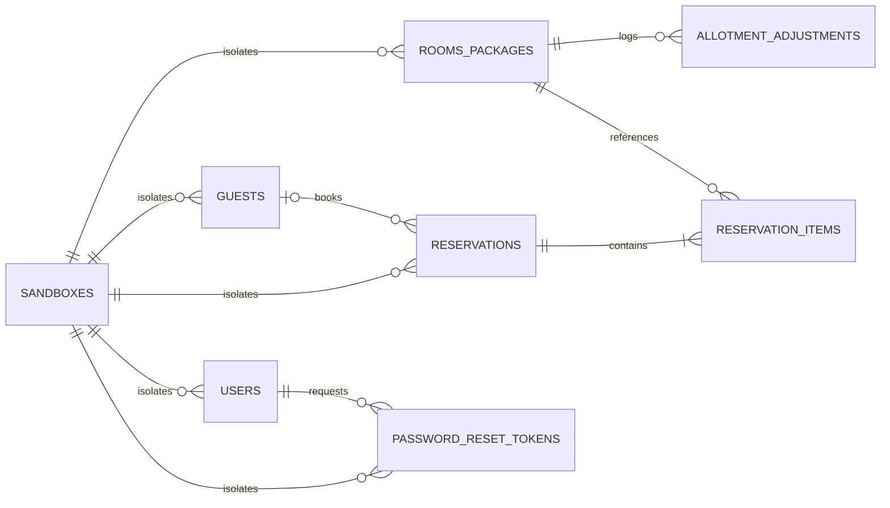

# Database Specification

**Status:** Schema and seed specification complete (Milestone M0).  
**Database Engine:** Supabase PostgreSQL 17 + Browser Storage Mirror (`veranda.v1.db` & `veranda.v1.session`).

---

## 1. Entity-Relationship Diagram

Every operational table in Supabase PostgreSQL is multi-tenant scoped by `sandbox_id UUID` (referencing `sandboxes.id ON DELETE CASCADE`) so that each browser session in the PUPQC BSIT *Defect Hunt* competition operates in an isolated sandbox slice that can be reset at any time via `reset_veranda_sandbox(p_sandbox_id UUID)`.



---

## 2. Supabase PostgreSQL Table Definitions

### 2.1 `sandboxes`
Tracks each browser's isolated competition environment.

| Column | Type | Constraints | Description |
|---|---|---|---|
| `id` | `UUID` | `PRIMARY KEY` | Client-generated or server-assigned sandbox UUID (`veranda.v1.sandbox_id`). |
| `created_at` | `TIMESTAMPTZ` | `NOT NULL DEFAULT now()` | When the sandbox was first initialized. |
| `last_reset_at` | `TIMESTAMPTZ` | `NOT NULL DEFAULT now()` | Timestamp of the most recent `"Reset demo data"` action (used to anchor relative seed dates). |
| `Anchor_date_local` | `DATE` | `NOT NULL` | Local calendar date (`Asia/Manila`) when the sandbox was seeded/reset. |

### 2.2 `users`
Stores resort staff and administrator accounts per sandbox.

| Column | Type | Constraints | Description |
|---|---|---|---|
| `id` | `TEXT` | `NOT NULL` | Logical user ID (e.g., `usr-admin-01`, `usr-staff-01`, `usr-former-01`). Composite PK `(sandbox_id, id)`. |
| `sandbox_id` | `UUID` | `FK sandboxes(id) ON DELETE CASCADE` | Owning sandbox tenant. |
| `name` | `VARCHAR(120)` | `NOT NULL` | Full display name (e.g., `Elena Marasigan`). |
| `email` | `VARCHAR(255)` | `NOT NULL` | Account email address. |
| `password` | `VARCHAR(255)` | `NOT NULL` | Stored password (`// @defect VH-14`: stored as plaintext in seed/mirror instead of a cryptographic hash). |
| `role` | `VARCHAR(16)` | `NOT NULL CHECK (role IN ('admin', 'staff'))` | Application role (`admin` or `staff`). |
| `is_active` | `BOOLEAN` | `NOT NULL DEFAULT true` | Whether the account is active (`false` for `former@verandapms.test`). |
| `failed_login_attempts` | `INT` | `NOT NULL DEFAULT 0` | Counter for brute-force lockout display (`VH-04`). |
| `locked_until` | `TIMESTAMPTZ` | `NULL` | Canonical lockout timestamp (`// @defect VH-04`: checked only for displaying message, not enforced on valid password). |
| `low_allotment_alerts` | `BOOLEAN` | `NOT NULL DEFAULT true` | User notification setting (`Settings > Notifications`). |
| `theme_preference` | `VARCHAR(16)` | `NOT NULL DEFAULT 'dark'` | User theme setting (`'dark'` or `'light'`, see `VH-53`). |
| `created_at` | `TIMESTAMPTZ` | `NOT NULL DEFAULT now()` | Creation timestamp. |

### 2.3 `rooms_packages`
Stores Solstice Bay Resort accommodations (villas, suites, casitas) and concierge packages (island tours, spa rituals, dining).

| Column | Type | Constraints | Description |
|---|---|---|---|
| `id` | `TEXT` | `NOT NULL` | Logical item ID (`rm-1001`..`rm-1020`). Composite PK `(sandbox_id, id)`. |
| `sandbox_id` | `UUID` | `FK sandboxes(id) ON DELETE CASCADE` | Owning sandbox tenant. |
| `code` | `VARCHAR(32)` | `NOT NULL` | Unique room/package code (`SB-1001`..`SB-1020`). Canonical uniqueness is case-insensitive (`// @defect VH-22`: checked case-sensitively). |
| `name` | `VARCHAR(255)` | `NOT NULL` | Display name (e.g., `Bamboo Horizon Deck Lounger`, `Premier Oceanfront Pool Villa`). |
| `category` | `VARCHAR(64)` | `NOT NULL` | One of: `Villas & Suites`, `Casitas & Rooms`, `Marine & Island Tours`, `Spa & Sanctuary`, `Dining & Lounge`. |
| `rate` | `NUMERIC(12,2)` | `NOT NULL` | Nightly or package unit rate in `PHP` (`> 0`). |
| `available_units` | `NUMERIC(10,2)` | `NOT NULL` | Current available allotment count (`// @defect VH-34`: allows fractional values when `2.5` quantity is ordered). Low allotment means `available_units <= 5`. |
| `status` | `VARCHAR(32)` | `NOT NULL DEFAULT 'active'` | `'active'` or `'archived'`. |
| `description` | `TEXT` | `NOT NULL DEFAULT ''` | Room/package description and amenities. |
| `version` | `INT` | `NOT NULL DEFAULT 1` | Optimistic concurrency counter (`// @defect VH-60`: ignored on save, allowing stale tab overwrites). |
| `updated_at` | `TIMESTAMPTZ` | `NOT NULL DEFAULT now()` | Last modified timestamp. |

### 2.4 `allotment_adjustments`
Audit trail of manual allotment additions or maintenance releases on a room/package.

| Column | Type | Constraints | Description |
|---|---|---|---|
| `id` | `TEXT` | `NOT NULL` | Adjustment ID. Composite PK `(sandbox_id, id)`. |
| `sandbox_id` | `UUID` | `FK sandboxes(id) ON DELETE CASCADE` | Owning sandbox tenant. |
| `room_package_id` | `TEXT` | `NOT NULL` | Target room/package ID. |
| `adjustment_type` | `VARCHAR(16)` | `NOT NULL CHECK (adjustment_type IN ('add', 'remove'))` | `'add'` (Return to service) or `'remove'` (Release to maintenance). |
| `quantity` | `NUMERIC(10,2)` | `NOT NULL` | Units added or removed. |
| `reason` | `VARCHAR(255)` | `NOT NULL` | Reason for adjustment (e.g., `Annual AC preventive maintenance`). |
| `performed_by` | `VARCHAR(120)` | `NOT NULL` | Staff/Admin actor name. |
| `created_at` | `TIMESTAMPTZ` | `NOT NULL DEFAULT now()` | Timestamp of adjustment. |

### 2.5 `guests`
Stores resort guest profiles.

| Column | Type | Constraints | Description |
|---|---|---|---|
| `id` | `TEXT` | `NOT NULL` | Logical guest ID (`gst-01`..`gst-12`). Composite PK `(sandbox_id, id)`. |
| `sandbox_id` | `UUID` | `FK sandboxes(id) ON DELETE CASCADE` | Owning sandbox tenant. |
| `name` | `VARCHAR(160)` | `NOT NULL` | Full guest name (e.g., `Maria Santos`, `Maria Reyes`, `Daniel Cruz`). |
| `email` | `VARCHAR(255)` | `NOT NULL` | Guest contact email. |
| `phone` | `VARCHAR(64)` | `NOT NULL` | Guest phone number (`// @defect VH-45`: unvalidated symbols accepted). |
| `address` | `VARCHAR(255)` | `NOT NULL` | Guest city/street billing address. |
| `loyalty_tier` | `VARCHAR(32)` | `NOT NULL DEFAULT 'Standard'` | `'Standard'`, `'Silver'`, `'Gold'`, or `'Founders Club'`. |
| `version` | `INT` | `NOT NULL DEFAULT 1` | Concurrency version counter (`VH-60`). |
| `created_at` | `TIMESTAMPTZ` | `NOT NULL DEFAULT now()` | Creation timestamp. |

### 2.6 `reservations`
Stores guest bookings and folio headers (`RSV-2001`..`RSV-2045`).

| Column | Type | Constraints | Description |
|---|---|---|---|
| `id` | `TEXT` | `NOT NULL` | Logical reservation ID (`rsv-2001`..`rsv-2045`). Composite PK `(sandbox_id, id)`. |
| `sandbox_id` | `UUID` | `FK sandboxes(id) ON DELETE CASCADE` | Owning sandbox tenant. |
| `reservation_number` | `VARCHAR(32)` | `NOT NULL` | Human-readable folio/reservation number (`RSV-2001`..`RSV-2045`). |
| `guest_id` | `TEXT` | `NULL` | Foreign reference to `guests.id` (`// @defect VH-46`: deleting a guest leaves `guest_id` dangling/orphaned with an empty guest cell). |
| `status` | `VARCHAR(32)` | `NOT NULL` | `'Pending'`, `'Confirmed'`, `'Checked In'`, `'Checked Out'`, or `'Cancelled'`. |
| `discount_percent` | `NUMERIC(6,2)` | `NOT NULL DEFAULT 0` | Discount percentage (`0` to `100` canonical; `VH-33` allows `< 0` or `> 100`). |
| `subtotal` | `NUMERIC(12,2)` | `NOT NULL` | Sum of line items (`unit_rate * quantity`). |
| `discount_amount` | `NUMERIC(12,2)` | `NOT NULL` | `subtotal * (discount_percent / 100)`. |
| `tax_amount` | `NUMERIC(12,2)` | `NOT NULL` | Canonical: `0.12 * (subtotal - discount_amount)`. (`// @defect VH-32`: computed as `0.12 * subtotal`). |
| `service_fee` | `NUMERIC(12,2)` | `NOT NULL DEFAULT 250.00` | Fixed `PHP 250.00` Resort Service & Environmental Fee. |
| `grand_total` | `NUMERIC(12,2)` | `NOT NULL` | `(subtotal - discount_amount) + tax_amount + service_fee`. |
| `notes` | `TEXT` | `NOT NULL DEFAULT ''` | Special requests / folio notes (`// @defect VH-15`: rendered unescaped on `/reservations/[id]/folio`). |
| `placed_at` | `TIMESTAMPTZ` | `NOT NULL` | Booking timestamp (stored in UTC; displayed in local time except `VH-44`). |
| `created_at` | `TIMESTAMPTZ` | `NOT NULL DEFAULT now()` | Record creation time. |

### 2.7 `reservation_items`
Line items belonging to a reservation.

| Column | Type | Constraints | Description |
|---|---|---|---|
| `id` | `TEXT` | `NOT NULL` | Line item ID. Composite PK `(sandbox_id, id)`. |
| `sandbox_id` | `UUID` | `FK sandboxes(id) ON DELETE CASCADE` | Owning sandbox tenant. |
| `reservation_id` | `TEXT` | `NOT NULL` | Owning reservation (`reservations.id`). |
| `room_package_id` | `TEXT` | `NOT NULL` | Referenced room/package (`rooms_packages.id`). |
| `quantity` | `NUMERIC(10,2)` | `NOT NULL` | Number of room-nights or package units booked. |
| `unit_rate_snapshot` | `NUMERIC(12,2)` | `NOT NULL` | Rate at booking time (`// @defect VH-29`: application reads live `rooms_packages.rate` instead of `unit_rate_snapshot`, causing historical reservation totals to mutate when a room/package rate is edited!). |

---

## 3. Browser Storage Mirror Contract (`localStorage`)

To ensure 100% compatibility with browser DevTools inspection defects (`VH-08`, `VH-13`, `VH-14`), the Hybrid Sandbox Store synchronizes the active sandbox to two deterministic keys in `window.localStorage`:

1. **`veranda.v1.session`**:
   ```json
   {
     "userId": "usr-staff-01",
     "email": "staff@verandapms.test",
     "name": "Marco Villanueva",
     "role": "staff",
     "rememberMe": false,
     "signedInAt": "2026-11-16T05:00:00.000Z"
   }
   ```
   - `// @defect VH-08`: Stored in `localStorage` even when `"Remember me"` is unchecked.
   - `// @defect VH-13`: Application UI and client permissions read `session.role` directly from `veranda.v1.session` in `localStorage` instead of re-verifying against the user record.

2. **`veranda.v1.db`**:
   ```json
   {
     "sandboxId": "a1b2c3d4-...",
     "theme": "dark",
     "users": [
       {
         "id": "usr-admin-01",
         "name": "Elena Marasigan",
         "email": "admin@verandapms.test",
         "password": "Admin@123",
         "role": "admin",
         "isActive": true
       }
     ],
     "roomsPackages": [...],
     "guests": [...],
     "reservations": [...],
     "resetTokens": [...]
   }
   ```
   - `// @defect VH-14`: User objects in `veranda.v1.db.users` store `"password": "Admin@123"` in plain text.

---

## 4. Canonical Seed Dataset Specification

The seed dataset is carefully calibrated so every single defect (`VH-01`..`VH-60`) has exact, named records and deterministic math:

### 4.1 Seed Users (3 Accounts)
| ID | Name | Email | Password | Role | Active |
|---|---|---|---|---|---|
| `usr-admin-01` | Elena Marasigan | `admin@verandapms.test` | `Admin@123` | `admin` | `true` |
| `usr-staff-01` | Marco Villanueva | `staff@verandapms.test` | `Staff@123` | `staff` | `true` |
| `usr-former-01` | Tricia Soriano | `former@verandapms.test` | `Former@123` | `staff` | `false` |

### 4.2 Key Seed Rooms & Packages (20 Items, `SB-1001` to `SB-1020`)
- **Category `Villas & Suites` contains exactly 12 items** (so Page 1 shows 10 items and Page 2 shows 2 items when filtered by `Villas & Suites`, enabling `VH-25` pagination filter drop testing).
- **Low Allotment (`available_units <= 5`) contains exactly 8 items** in the canonical seed:
  - 7 items have `available_units < 5` (`0` to `4` units)
  - **1 item (`SB-1006` — `"Coral Reef Private Cabana"`) has `available_units = 5`** (right on the boundary `<= 5` vs `< 5`, so the Dashboard Low Allotment KPI shows `8`, while the Low Allotment Watchlist table using `< 5` only lists `7` rows — `VH-17`!).
- **Specific Named Seed Items Used in Defect Scenarios**:
  - `SB-1001`: **Premier Oceanfront Villa** — Rate `6,400.00`, Allotment `12`, Category `Villas & Suites` (used in `VH-22` case-sensitive code `sb-1001` and `VH-26` price sort).
  - `SB-1002`: **Teakwood Lanai Daybed** — Rate `500.00`, Allotment `26`, Category `Villas & Suites` (used in `RSV-2045` x2 = `1,000.00` + `120.00` VAT + `250.00` fee = `1,370.00` for `VH-29`, `VH-36`, `VH-39`, `VH-43`).
  - `SB-1003`: **Sunset Catamaran Charter** — Rate `1,200.00`, Allotment `18`, Category `Marine & Island Tours` (used in `VH-32` x2 = `2,400.00`, discount 10%).
  - `SB-1004`: **Cabana Suite, Poolside** — Rate `950.00`, Allotment `34`, Category `Villas & Suites` (contains a comma `,` in its name for `VH-49` CSV unquoted comma shift and `VH-38` double allotment deduction).
  - `SB-1005`: **Botanical Welcome Amenity Set** — Rate `250.00`, Allotment `96`, Category `Dining & Lounge` (paired with `SB-1004` in `RSV-2043` for `VH-38`).
  - `SB-1006`: **Coral Reef Private Cabana** — Rate `990.00`, Allotment `5`, Category `Villas & Suites` (exact boundary `available_units = 5` for `VH-17`).
  - `SB-1007`: **Cliffside Infinity Pavilion** — Rate `0` allotment (`available_units = 0`, badge `"Out of allotment"`), Rate `1,800.00` (used in `VH-31` ordering an out-of-allotment item).
  - `SB-1008`: **Terracotta Courtyard Suite** — Rate `975.00`, Allotment `7`, Category `Villas & Suites` (used in `VH-30` Adjust Allotment -> Remove 50 -> becomes `-43`).
  - `SB-1009`: **Solstice Bay Presidential Sanctuary Three-Bedroom Cliffside Oceanfront Pool Villa with Private Butler Service** — Rate `4,500.00`, Allotment `4` (extra-long 109-character name used in `VH-24` horizontal overflow on Create Reservation).
  - `SB-1010`: **Eucalyptus Steam & Spa Ritual** — Rate `900.00`, Allotment `15`, Category `Spa & Sanctuary` (used in `VH-28` Edit Cancel bug where changing name + rate and clicking Cancel still saves the new rate).
  - `SB-1011`: **Island Kayaking & Snorkeling Expedition** — Rate `750.00`, Allotment `23`, Category `Marine & Island Tours` (used in `VH-35` adding two lines of quantity `20` each -> stock becomes `-17`).

### 4.3 Key Seed Guests (10 Profiles)
- **Maria Santos** (`gst-01`): 6 seeded reservations (`VH-47`).
- **Maria Reyes** (`gst-02`): 3 seeded reservations, including `RSV-2045` (`VH-43`, `VH-47` — Guest Detail matches history by first name `"Maria"`, showing all 9 reservations on both Maria Santos and Maria Reyes!).
- **Daniel Cruz** (`gst-03`): Has 2 seeded reservations (`VH-46` — deleting Daniel Cruz succeeds and leaves his reservations with an empty guest cell that links to a blank page).
- Additional realistic guests: `Rafael Mendoza`, `Camille Bautista`, `Lorenzo Villanueva`, `Bianca Navarro`, `Gabriel Aquino`, `Clarisse Ocampo`, `Kenji Tan`.

### 4.4 Key Seed Reservations (`RSV-2026` to `RSV-2045`)
- **`RSV-2045`** (Most recent, placed today, status `Confirmed`, Guest `Maria Reyes`):
  - Item: `Teakwood Lanai Daybed` (`SB-1002`, rate `500.00`) x `2` = Subtotal `1,000.00`, Discount `0%`, VAT (12%) = `120.00`, Service Fee = `250.00`, **Grand Total = `1,370.00`**.
  - Used for:
    - `VH-29` (Editing `Teakwood Lanai Daybed` rate changes `RSV-2045`'s existing total)
    - `VH-36` (Cancelling `RSV-2045` from `Confirmed` fails to restore `Teakwood Lanai Daybed` allotment from `26` to `28`)
    - `VH-39` (Detail page adds the `250.00` Service Fee twice, showing `1,620.00` instead of `1,370.00`)
    - `VH-43` (Folio `/reservations/rsv-2045/folio` omits the `250.00` Service Fee from Grand Total, showing `1,120.00`, and omits `Maria Reyes`'s name in `"Billed To"`)
    - `VH-50` (CSV export drops the last row, `RSV-2045`).
- **`RSV-2044`** (Placed today, status `Pending`, 5% discount):
  - Used to compare `Pending -> Cancelled` (which properly restores allotment) against `RSV-2045` (`Confirmed -> Cancelled`, which fails to restore allotment in `VH-36`), and to demonstrate `VH-32` tax-before-discount calculation.
- **`RSV-2043`** (Placed today, status `Pending`):
  - Items: `Cabana Suite, Poolside` (`SB-1004`, allotment `34`) x `1` and `Botanical Welcome Amenity Set` (`SB-1005`, allotment `96`) x `3`.
  - Used for `VH-38` (changing status from `Pending` to `Confirmed` deducts allotment a second time -> `33` and `93`) and `VH-49` (CSV export unquoted comma in `"Cabana Suite, Poolside"`).
- **`RSV-2037`** (Placed 10 days ago, within `Last 30 days`, status `Cancelled`):
  - Used for `VH-16` (Dashboard `Last 30 days` Total Revenue includes `Cancelled` reservation `RSV-2037`), `VH-20` (Dashboard ABV divides by total reservations count including `RSV-2037`), and `VH-37` (Cancelled reservation `RSV-2037` status dropdown offers reopening to `Checked In`, `Checked Out`, etc.).
- **First-of-Month Midnight Reservation** (Placed at `12:30 AM Asia/Manila` on the 1st of the previous calendar month, i.e., `16:30 UTC` on the last day of two months ago):
  - Used for `VH-18` (Dashboard monthly chart groups by UTC month, placing this reservation into the wrong month bar compared to Reports).
