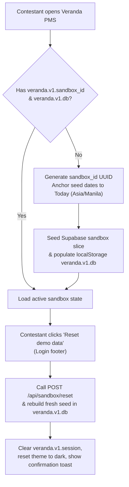
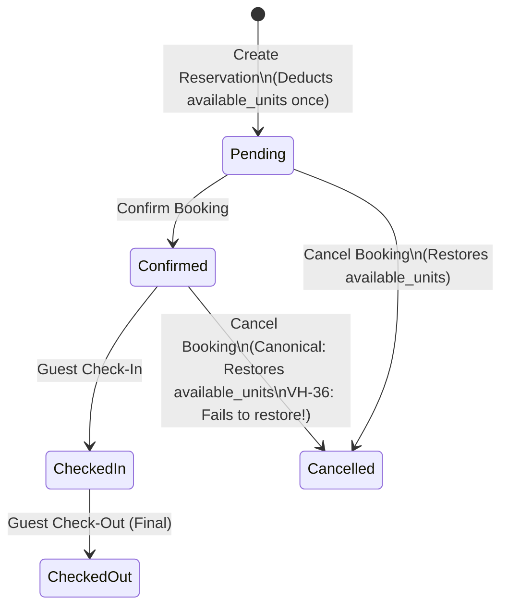

# User Workflows Specification

**Status:** Approved workflow baseline (Milestone M0).  
**Reference:** See [FRS_NFRS.md](FRS_NFRS.md) for canonical rules and [DEFECT_CATALOG.md](DEFECT_CATALOG.md) for the 60 intentional defect deviations (`VH-01`..`VH-60`).

---

## 1. Sandbox Initialization & "Reset Demo Data" Workflow

1. Every browser automatically initializes an isolated sandbox on first visit.
2. At any point during the competition, clicking **Reset demo data** in the login page footer restores all 3 seed accounts, 20 rooms/packages (`SB-1001`..`SB-1020`), 10 guests, and 20 seeded reservations (`RSV-2026`..`RSV-2045`) to their exact initial values anchored to the current date.

---

## 2. Authentication, Registration & Password Recovery Workflows

### 2.1 Sign In (`/login`)
- User enters **Email** and **Password**, optionally ticks **Remember me**, and clicks **Sign in** (or presses `Enter`).
- **Canonical Flow**: Email is trimmed and matched case-insensitively; active status (`is_active = true`) and password are verified; failed attempts increment a counter and lock the account after 5 failures; session is stored in `sessionStorage` (if Remember Me is unchecked) or `localStorage` (if checked); user is redirected to `/dashboard`.
- **Planted Defect Deviations**:
  - `VH-01`: Untrimmed email with leading/trailing spaces is rejected.
  - `VH-02`: Pressing `Enter` in the Password field does not submit the form (`Enter` in Email submits).
  - `VH-03`: Non-existent email returns `"Invalid email or password."` while wrong password on an existing email returns `"Incorrect email or password."`
  - `VH-04`: After 5 wrong attempts, `"Too many attempts, try again later."` is shown, but entering the valid password on the 6th attempt logs in immediately.
  - `VH-08`: Session is always written to `localStorage` (`veranda.v1.session`) even when `"Remember me"` is unchecked.
  - `VH-09`: Signing in as deactivated user `former.group1@verandapms.test` (`Former@123`) is blocked when `"Remember me"` is unchecked, but **succeeds** when `"Remember me"` is ticked.

### 2.2 Self-Registration (`/register`)
- User enters Full Name, Email, Password, and Confirm Password.
- **Planted Defect Deviations**:
  - `VH-05`: Password mismatch (`password !== confirmPassword`) is only rejected when `password.length < 12`; when `password.length >= 12`, mismatched confirmation is accepted and creates the account.
  - `VH-06`: Email uniqueness check is case-sensitive (`Admin.group1@verandapms.test` is allowed even though `admin.group1@verandapms.test` exists).

### 2.3 Forgot & Reset Password (`/forgot-password` -> `/reset-password?token=...`)
- User submits their email on `/forgot-password`. An in-app simulated email banner displays an **"Open reset link"** button with a 30-minute token URL.
- **Planted Defect Deviation (`VH-07`)**: After setting a new password with the reset link, opening the same copied URL a second time allows resetting the password again instead of invalidating the token after first use.

---

## 3. Rooms & Packages Management Workflow (`/rooms`, `/rooms/[id]`)

1. **Browse, Filter, Sort, and Paginate**:
   - Users search by name/code, filter by Category (`Villas & Suites`, `Casitas & Rooms`, `Marine & Island Tours`, `Spa & Sanctuary`, `Dining & Lounge`), filter by Status (`All`, `In Stock / Available`, `Low Allotment`, `Out of Allotment`), and sort by Name, Rate, or Allotment.
   - **Planted Defect Deviations**:
     - `VH-25`: Filtering by Category (`Villas & Suites`, 12 items) and clicking Next / Page 2 drops the Category filter and shows Page 2 of all items.
     - `VH-26`: Sorting by `Rate (high to low)` sorts rates as strings (`990.00`, `975.00`, `950.00`, `900.00` appear above `6,400.00` and `1,200.00`), whereas `Rate (low to high)` sorts numerically.
2. **Create / Edit Room or Package**:
   - Staff or Admin opens the Add/Edit modal.
   - **Planted Defect Deviations**:
     - `VH-21`: Negative allotment (e.g., `-7`) is accepted.
     - `VH-22`: Duplicate code check is case-sensitive (`sb-1001` is accepted when `SB-1001` exists).
     - `VH-23`: Whitespace-only name (`"   "`) is accepted and saved.
     - `VH-28`: In Edit Room/Package, changing both Name and Rate and clicking **Cancel** discards the name change but mutates and saves the new Rate.
3. **Adjust Allotment**:
   - Staff or Admin clicks **Adjust Allotment**, chooses `Add` or `Remove`, enters a quantity and reason, and submits.
   - **Planted Defect Deviation (`VH-30`)**: Selecting `Remove` with a quantity larger than current `available_units` (e.g., removing `50` from `Terracotta Courtyard Suite` with allotment `7`) is accepted, resulting in `-43`.
4. **Delete Room or Package**:
   - On `/rooms`, Delete is hidden for `staff` and prompts a confirmation dialog for `admin`.
   - **Planted Defect Deviations**:
     - `VH-11`: On the detail page `/rooms/[id]`, the **Delete** button is visible and functional for `staff`.
     - `VH-27`: Clicking **Delete** on `/rooms/[id]` deletes the record immediately without a confirmation dialog.

---

## 4. Reservation Creation, Status Lifecycle & Folio Workflow

### 4.1 Create Reservation (`/reservations/new`)
1. Staff/Admin selects a **Guest**, verifies **Reservation Date**, adds one or more **Room / Package lines** with **Quantity**, enters optional **Discount (%)** and **Special Requests / Notes**, reviews the live **Folio Summary**, and clicks **Place Reservation**.
2. **Canonical Calculation**:
   - `Subtotal = sum(rate * quantity)`
   - `Discount = Subtotal * (discount_percent / 100)`
   - `Tax (12% VAT) = 0.12 * (Subtotal - Discount)`
   - `Service & Environmental Fee = 250.00`
   - `Grand Total = (Subtotal - Discount) + Tax + 250.00`
3. **Planted Defect Deviations**:
   - `VH-24`: Selecting `SB-1009` (long villa name) stretches the row horizontally out of view.
   - `VH-31`: Out-of-allotment item `Cliffside Infinity Pavilion` (`0` available) can still be added and booked, driving allotment negative.
   - `VH-32`: Whenever a discount is applied, `12% VAT` is calculated on gross `Subtotal` instead of `(Subtotal - Discount)`.
   - `VH-33`: Discount values outside `0..100` (such as `150` or `-20`) are accepted.
   - `VH-34`: Quantity `0` or fractional `2.5` is accepted (resulting in fractional allotment).
   - `VH-35`: Adding the same item (`Island Kayaking & Snorkeling Expedition`, `23` available) twice as two separate lines of `20` each bypasses per-line stock validation and sets allotment to `-17`.
   - `VH-41`: Double-clicking **Place Reservation** creates two identical consecutive reservations and deducts allotment twice.
   - `VH-42`: Future reservation dates are accepted, and `/reservations/[id]` renders the date as `DD/MM/YYYY` instead of `MM/DD/YYYY`.

### 4.2 Status Transitions & Detail Inspection (`/reservations/[id]`)
- **Planted Defect Deviations**:
  - `VH-29`: Editing a room/package's rate in `/rooms` retroactively alters the unit price and total of existing reservations containing that item.
  - `VH-36`: Cancelling a `Confirmed` reservation (`RSV-2045`) fails to restore `available_units` (stays `26` instead of becoming `28`), whereas cancelling a `Pending` reservation (`RSV-2044`) restores allotment properly.
  - `VH-37`: `Checked Out` and `Cancelled` (`RSV-2037`) reservations allow moving status backwards or reopening via the status selector.
  - `VH-38`: Changing `RSV-2043` from `Pending` to `Confirmed` deducts `available_units` a second time.
  - `VH-39`: The Reservation Detail page (`/reservations/[id]`) adds the `250.00` Service & Environmental Fee twice in its displayed Total (`1,620.00` instead of `1,370.00` for `RSV-2045`).
  - `VH-44`: The Reservation Detail `"Placed ..."` timestamp displays UTC time instead of browser local time (`8 hours earlier` in `Asia/Manila`).

### 4.3 View & Print Guest Folio (`/reservations/[id]/folio`)
- Clicking **View Folio / Invoice** on `/reservations/[id]` opens the printable statement.
- **Planted Defect Deviations**:
  - `VH-15`: Reservation `notes` containing HTML/JS (e.g., ``) are escaped on `/reservations/[id]` but rendered via `dangerouslySetInnerHTML` on `/reservations/[id]/folio`, firing stored XSS.
  - `VH-43`: On `/reservations/[id]/folio`, the Grand Total omits the `250.00` Service & Environmental Fee (`1,120.00` instead of `1,370.00` on `RSV-2045`) and the guest's name (`Maria Reyes`) is missing from the `"Billed To"` block (showing only email, phone, and address).

---

## 5. Guests, Reports, Users & Settings Workflows

- **Guests (`/guests`, `/guests/[id]`)**:
  - `VH-45`: Phone field accepts arbitrary symbols (`abc!!##xyz`).
  - `VH-46`: Deleting `Daniel Cruz` (who has existing reservations) succeeds and leaves his rows in `/reservations` with an empty Guest cell that links to a blank page.
  - `VH-47`: Guest detail reservation history matches by first name (`name.split(' ')[0]`), so `Maria Santos` (6 bookings) and `Maria Reyes` (3 bookings) both display 9 bookings on their detail pages.
- **Reports (`/reports`)**:
  - `VH-48`: Setting `End Date < Start Date` shows no validation error and returns all reservations across all dates.
  - `VH-49`: Exporting CSV with `"Cabana Suite, Poolside"` leaves the comma-containing field unquoted, shifting subsequent columns.
  - `VH-50`: Exporting CSV omits the final row (`slice(0, -1)`), dropping the most recent reservation (`RSV-2045`).
  - `VH-51`: Report summary `Total Revenue` excludes the `250.00` per-reservation Service Fee, so it never matches the table column sum or the Dashboard.
- **Users (`/users`) & Settings (`/settings`)**:
  - `VH-10`: Typing `/users` in the URL bar while logged in as `staff` opens the full Users administration page.
  - `VH-12`: Logged in as `admin`, clicking **Deactivate** on your own row deactivates your own Admin account and logs you out on next load.
  - `VH-52`: Changing password in Settings does not verify `Current password`.
  - `VH-54`: Updating Full Name in Settings does not update the topbar name/initials or Dashboard greeting until a full browser refresh.
  - `VH-55`: Turning `"Low allotment alerts"` off in Settings empties the notification bell dropdown (`"You are all caught up."`) but leaves the numeric badge `8` visible on the bell icon.
